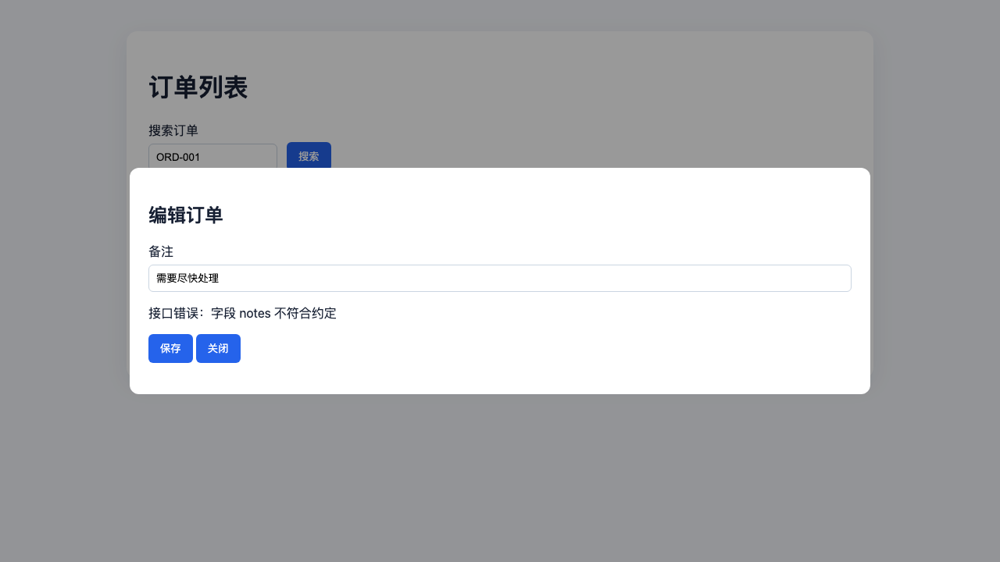

# AI 前端验收组件

一个独立的 Node.js/TypeScript 验收执行器。外部 AI 提供页面、交互和 API 的标准化任务；本工具使用真实浏览器执行场景，记录请求与响应证据，最后输出后续 Agent 可以继续消费的标准结果。模型复核属于可选的外部扩展，不是执行器的必要依赖。

## 它解决什么问题

AI 生成的页面可能“看起来完成”，但仍然存在：

- 搜索条件没有进入请求；
- 分页参数错误；
- 表单字段和 API 契约不一致；
- 弹窗、保存、失败反馈不完整；
- 没有截图和真实请求证据。

组件把这些问题转换成可执行的输入和可审查的输出。它不绑定 Vue、React 或其他前端框架，也不绑定某种后端语言或特定 Agent。

## 工作流

```text
上游 Agent 编写 acceptance-spec.yaml
        ↓
输入规范校验与规范化
        ↓
场景指纹和影响范围分析
        ↓
执行未验证或已变化的场景
        ↓
Playwright 采集页面、截图、请求、响应和 Trace
        ↓
规则引擎判定
        ↓
acceptance-result.json
        ↓
后续 Agent 修复、继续开发或确认通过
```

## 快速开始

```bash
npm install
npm run build
npm run plan -- examples/demo/acceptance-spec.yaml
```

启动示例 API 和页面：

```bash
node examples/demo/server.mjs
```

另开终端执行通过版验收：

```bash
PLAYWRIGHT_BROWSERS_PATH=/Volumes/1T/codex-cache/frontend-api-evidence-gate/ms-playwright \
  npm run acceptance -- examples/demo/acceptance-spec.yaml \
  --output /Volumes/1T/codex-cache/frontend-api-evidence-gate/artifacts/demo
```

通过版会验证搜索、编辑弹窗、PATCH 请求、响应和“保存成功”提示，结果为 `pass`。

### Edge 和 Windows

可以通过系统 Edge 通道启动 Microsoft Edge：

```powershell
acceptance-runner run acceptance-task.json --browser edge --headed
```

也可以连接已经打开的 Edge 标签页：

```powershell
msedge.exe --remote-debugging-port=9222
acceptance-runner run acceptance-task.json `
  --target existing `
  --browser edge `
  --cdp-endpoint http://127.0.0.1:9222 `
  --tab-url https://test.example.com/orders
```

`--browser edge` 使用系统安装的 Microsoft Edge，不会下载 Playwright 自带浏览器。Windows 下可使用 PowerShell 或 `acceptance-runner.cmd`。

目标模式和运行保护：

```bash
acceptance-runner run acceptance-task.json \
  --target existing \
  --cdp-endpoint http://127.0.0.1:9222 \
  --tab-url https://test.example.com/orders \
  --timeout 30000 \
  --max-response-bytes 1048576
```

外部 Agent 也可以启动本地入口：

```bash
acceptance-runner-server --port 3777
```

HTTP 使用 `POST /run`；传入 `async: true` 后，可通过 `GET /jobs/:jobId` 查询，并用 `POST /jobs/:jobId/cancel` 取消。MCP 使用 `POST /mcp` 的 `tools/list` 和 `tools/call`。

## 演示：验收一个有问题的页面

[examples/demo/README.md](examples/demo/README.md) 展示了完整的失败案例。问题页面故意：

- 把 `pageSize=20` 错发成 `pageSize=10`；
- 把请求体字段 `remark` 错发成 `notes`；
- 接收到 API 422 后显示错误提示，但没有完成成功流程。

运行：

```bash
PLAYWRIGHT_BROWSERS_PATH=/Volumes/1T/codex-cache/frontend-api-evidence-gate/ms-playwright \
  npm run acceptance -- examples/demo/bad-page/acceptance-spec.yaml \
  --output /Volumes/1T/codex-cache/frontend-api-evidence-gate/artifacts/bad-page
```

预期结果是 `fail`。项目内已经保存了一份可直接查看的结果：

- [失败结果 JSON](examples/demo/bad-page/output/acceptance-result.json)
- [实际请求明细](examples/demo/bad-page/output/requests.json)
- [实际响应结果](examples/demo/bad-page/output/responses.json)
- [断言明细](examples/demo/bad-page/output/checks.json)
- [失败场景截图](examples/demo/bad-page/output/screenshot.png)



## 输入和输出

输入文件是 `acceptance-spec.yaml`，声明：

- 页面和路由；
- 按钮、输入、弹窗和可访问定位器；
- 用户操作步骤；
- API 路径、方法、query、body 和响应要求；
- 测试数据、视口和质量要求；
- 页面、组件、API、schema 和全局样式依赖。

输出目录包含：

```text
acceptance-result.json  # 标准结果、结论、指纹和证据索引
screenshot.png          # 最终页面截图
requests.json           # URL、方法、参数、请求体
responses.json          # 状态码、耗时、响应体
checks.json             # expected / actual / status
trace.zip               # Playwright 调试证据
```

结果结论为：

- `pass`：规则和模型复核均通过；
- `fail`：确定性规则失败；
- `blocked`：页面、API、数据或执行环境不可用；
- `needs_review`：证据不足或模型发现语义问题。

## 运行时实现

- `acceptance-runner`：CLI 入口；
- `runAcceptance()`：TypeScript 库接口；
- Playwright：浏览器执行和证据采集；
- Ajv + JSON Schema：输入和结果协议校验；
- `ModelAdapter`：可选的外部模型复核适配器；
- 指纹选择器：判断场景是否可以复用上次结果。

默认不调用模型。需要语义复核时，由外部 Agent 或显式注入的 `ModelAdapter` 完成。

## 目录

- `src/`：执行器实现
- `schemas/`：输入和输出 JSON Schema
- `examples/demo/`：通过版和问题版完整演示
- `docs/`：总体方案、执行流程和重验策略
- `docs/README.md`：文档索引和阅读顺序
- `docs/01-外部AI驱动验收执行器方案.md`：外部 AI 调用协议、浏览器接入和证据输出方案
- `templates/`：接入项目的 CI、Makefile 和规格模板
